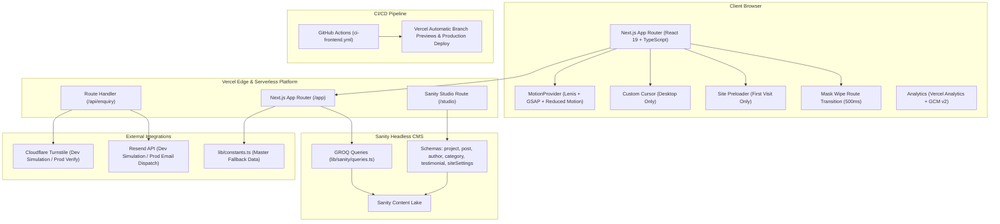
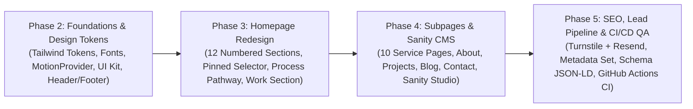

# ThunSpark Master Website Redesign Plan (Build Guide v1.2 — Aligned & Execution-Ready)

## Goal Description

Transition the ThunSpark repository into the unified, high-performance architecture specified in the **ThunSpark Master Website Build Guide (v1.2)**.

Following the design alignment decisions:
1. The **legacy Django backend** has been completely removed (along with Docker Compose workflows), shifting 100% of the active site to a **Next.js 16 (App Router)** setup on **Vercel**.
2. Content management adopts a **Dual-Mode Sanity Architecture**: Sanity Studio embedded at `/studio` with full schemas (`project`, `post`, `author`, `category`, `testimonial`, `siteSettings`), seamlessly falling back to `lib/constants.ts` and `site.config.ts` when credentials are unset.
3. The **4 confirmed case studies** (Coo & Cry, Medilove, Suncity Fire, Homeware Expo) will be pre-seeded in Scope & Overview mode with unverified metric blocks hidden per the zero-fabrication rule.
4. The lead submission route (`/api/enquiry/route.ts`) includes a **Dev Simulation Fallback** for Cloudflare Turnstile and Resend, strictly enforcing live delivery in production.
5. Desktop UI features the **Full Cinematic Motion System** (§R5): site preloader, custom cursor with contextual labels, mask-wipe route transitions, and Lenis smooth scrolling.

---

## Confirmed Architectural Decisions (Design Interview Log)

| Decision Branch | Resolution |
| :--- | :--- |
| **Backend & Repo Structure** | Remove legacy Django `backend/` and `docker-compose.yml` completely; keep repository root clean for Next.js. |
| **Sanity CMS Strategy** | Dual-mode fallback: build schemas and embedded `/studio`, but pull default data from `lib/constants.ts` when Sanity env vars are unset so build/dev never fail. |
| **Projects Initial State** | Pre-seed the 4 confirmed case studies (Coo & Cry, Medilove, Suncity Fire, Homeware Expo) as Scope & Overview showcases; hide unverified metric blocks. |
| **Lead Submission Pipeline** | Serverless route handler (`/api/enquiry`) with Zod + Turnstile + Resend. Includes dev console simulation fallback when API keys are placeholders. |
| **Motion Experience** | Full cinematic motion per Guide §R5: custom cursor (desktop only), mask wipe route transitions, site preloader, Lenis smooth scrolling, and reduced-motion matrix. |
| **CI/CD Pipeline** | Retain automated GitHub Actions workflow (`ci-frontend.yml`) running linting, strict TypeScript checks (`npx tsc --noEmit`), and Next.js production builds. |

---

## Architecture Overview



---

## 1. Prep Strategy: Design Tokens, Styling & Fonts

### 1.1 Design Token Specification (Build Guide §B2 & §R6)

The design system standardizes on a dark, editorial, low-saturation canvas with high-contrast functional accents:

| Token Name | Hex Value | Purpose & CSS Variable | WCAG / Usage Rule |
| :--- | :--- | :--- | :--- |
| **`base`** | `#050505` | `--color-base` (Page canvas background) | Default background |
| **`alt`** | `#0A0A0A` | `--color-alt` (Alternate section background) | Section contrast banding |
| **`card`** | `#111111` | `--color-card` (Default card surface) | Standard container surfaces |
| **`elevated`** | `#171717` | `--color-elevated` (Hovered/elevated panels) | Interactive hover & popovers |
| **`ink`** | `#F5F5F0` | `--color-ink` (Primary heading & body text) | 16.5:1 on `#050505` (AAA) |
| **`soft`** | `#A6A6A0` | `--color-soft` (Secondary text, descriptions) | 8.2:1 on `#050505` (AAA) |
| **`muted`** | `#6F6F6A` | `--color-muted` (Large uppercase labels only) | $\ge$ 18px text only (AA Large) |
| **`meta`** | `#8A8A85` | `--color-meta` (Small captions, pills, metadata) | 4.8:1 on `#050505` (AA Normal) |
| **`accent`** | `#FFD21F` | `--color-accent` (Thunder yellow brand primary) | Max 5% viewport coverage |
| **`accentHi`** | `#FFE75A` | `--color-accent-hi` (Hover state only) | Interactive buttons/links hover |
| **`accentDeep`** | `#C9A900` | `--color-accent-deep` (Pressed state / active text) | Pressed states & small text |
| **`line`** | `#252525` | `--color-line` (Default 1px structural borders) | Subtle border separation |
| **`lineStrong`** | `#353535` | `--color-line-strong` (Interactive card borders) | Hover border highlight |
| **`success`** | `#47C78A` | `--color-success` (Form & validation success) | Passes AA on dark |
| **`warning`** | `#FFBF47` | `--color-warning` (Form & status warnings) | Passes AA on dark |
| **`error`** | `#FF6464` | `--color-error` (Form validation errors) | Error text with `aria-describedby` |

### 1.2 Approved Gradients & Visual Rules
- **Thunder Accent Gradient (`--gradient-thunder`)**: `linear-gradient(135deg, #FFD21F 0%, #FFE75A 50%, #FFD21F 100%)`.
- **Dark Surface Gradient (`--gradient-dark`)**: `linear-gradient(180deg, #111111 0%, #050505 100%)`.
- **Single Approved Radial Glow (§D1 §11)**: `radial-gradient(600px at 85% 0%, rgba(255, 210, 31, 0.07), transparent 70%)` on the Final CTA panel.
- **Zero Box Shadows**: Elevation is achieved exclusively via background color stepping (`base` $\rightarrow$ `card` $\rightarrow$ `elevated`) and 1px `line`/`lineStrong` borders.
- **Film Grain Overlay (§R5)**: Ultra-subtle noise overlay (`opacity \le 0.04`) applied strictly to the Hero and Final CTA sections.

### 1.3 Font Stack & Typography Integration
1. **Display Font**: `Space Grotesk` (`weights: 500, 700`) via `next/font/google` $\rightarrow$ `--font-display`.
2. **Body Font**: `Inter` (`weights: 400, 500, 600`) via `next/font/google` $\rightarrow$ `--font-body`.
3. **Eyebrows & Editorial Labels**: `Space Mono` (`weights: 400, 700`) via `next/font/google` $\rightarrow$ `--font-mono`.
4. **Fluid Type Scale**:
   - `display-lg`: `clamp(2.75rem, 6vw, 5rem)` (Line height: `1.04`, tracking: `-0.03em`)
   - `display`: `clamp(2.25rem, 4.5vw, 3.5rem)` (Line height: `1.08`, tracking: `-0.02em`)
   - `h2`: `clamp(1.875rem, 3.2vw, 2.75rem)` (Line height: `1.12`, tracking: `-0.02em`)
   - `h3`: `clamp(1.375rem, 2vw, 2rem)` (Line height: `1.2`)
   - `lead`: `1.25rem` (Line height: `1.6`)
   - `body`: `1.0625rem` (Line height: `1.65`)
   - `caption`: `0.8125rem` (Line height: `1.5`, tracking: `0.05em`)

### 1.4 Non-Conflicting Tailwind Integration Strategy
1. Update `frontend/src/app/globals.css` with standard CSS variables (`--color-base`, `--color-accent: #FFD21F`, etc.) while retaining backwards-compatible aliases (`--bg-primary: var(--color-base)`, `--accent: var(--color-accent)`).
2. Configure Tailwind CSS `@theme` block with the complete set of tokens (`base`, `alt`, `card`, `elevated`, `ink`, `soft`, `muted`, `meta`, `accent`, `accentHi`, `accentDeep`, `line`, `lineStrong`).
3. Retain backwards-compatible utility class mappings during the transition so components rendering `bg-bg-primary` automatically map to `#050505` and `text-accent` automatically maps to `#FFD21F`.

---

## 2. Component Audit: Keep vs. Refactor vs. Replace

| Existing Component | Current Role | Target State (Guide v1.2) | Action | Specific Refactoring Required |
| :--- | :--- | :--- | :--- | :--- |
| **`Header.tsx`** | Fixed top bar with 6 static text links | 80px fixed header with **Services MegaMenu (5-column dropdown)**, logo SVG with lightning mark, and primary CTA button "Get a growth audit" ($\ge$ `lg` screens) | **REFACTOR** | Add `MegaMenu.tsx` (desktop hover-intent & keyboard `Esc` listener, mobile accordion), update CTA text to "Get a growth audit", wire `/services#slug` anchors. |
| **`Footer.tsx`** | Standard 4-column footer | 4-column layout per §D1 §12 with official tagline, BackToTop button, verified social links, and DPDP/GDPR performance disclaimer | **REFACTOR** | Replace copy with Guide §D1 §12 text, add performance disclaimer, add `BackToTop` 44px circular button with smooth scroll. |
| **`Button.tsx`** | Generic Framer Motion button | High-contrast button (`primary` with `#FFD21F` & `#050505` text, `secondary` with 1px `line` border, `ghost`) | **REFACTOR** | Update styles to use `rounded-[999px]`, 10px / 12px padding, exact hover states (`accentHi`), outexpo easing, and `data-analytics-cta` tracking. |
| **`Card.tsx`** | Generic card component | Surface card (`bg-card`, border `line`, hover border `lineStrong`, no box shadows) | **REFACTOR** | Enforce strict surface elevation rules and `rounded-[var(--radius-card)]`. |
| **`Badge.tsx`** | Generic pill badge | Editorial `Tag` (border pill with meta text) and `Chip` (soft text on elevated surface) | **REFACTOR** | Split into distinct `Tag` and `Chip` components matching §C1 spec. |
| **`Input.tsx`** | 3-step contact inputs | 56px height, radius 10px, line border, `accentDeep` active state, error state with `aria-describedby` | **REFACTOR** | Adapt to single-page contact form with floating label / explicit label + describedby error semantics. |
| **`InteractiveGrowthSystem.tsx`** | 6-stage Discover $\rightarrow$ Grow system | Replaced on homepage by **§4 Solutions Selector** (4 pills: Attract, Engage, Convert, Optimize) and **§5 Process Pathway** (5 nodes: Diagnose, Strategize, Build, Launch, Measure) | **REPLACE** | Create dedicated `SolutionsSelector.tsx` (tilted-pill pinned scrubber) and `ProcessPathway.tsx` (SVG line scrub animation). |
| **`InteractiveServiceShowcase.tsx`** | Accordion service cards | 4-group solutions selector on homepage; dedicated chapters on `/services` | **REPLACE** | Replace with `SolutionsSelector.tsx` on homepage and `ServicesChapters.tsx` on `/services`. |
| **`ContactForm.tsx`** | 3-step wizard form with Django API submission | Single-card high-conversion form with Cloudflare Turnstile, Zod validation, and optional budget/timeline selects | **REFACTOR** | Remove wizard stepping; implement single-card layout with Turnstile verification, Resend route handler `/api/enquiry`, and honeypot. |
| **`BlogListingView.tsx`** | Client-side filterable blog list | Editorial blog listing with search input, category chips, pagination after 9 items, and Sanity GROQ integration | **REFACTOR** | Connect to Sanity `allPostsQuery` (`getAllPosts`) with `lib/constants.ts` fallback; enforce hiding section if 0 published posts. |
| **`CookieConsentBanner.tsx`** | Glassmorphic cookie banner | Lightweight custom banner ("We use privacy-friendly analytics... [Accept] [Reject]") with localStorage persistence and footer revoke | **REFACTOR** | Align with Guide §F3; default to Vercel Analytics + Speed Insights (cookieless); GA4 gated strictly behind consent. |
| **`RouteTracker.tsx`** | Virtual page view tracker | DataLayer virtual page view tracker | **KEEP** | Verify event taxonomy matches Guide §F3 (`page_path`, `page_title`). |
| **`ScrollDepthTracker.tsx`** | Scroll milestones (25-100%) | SPA-aware scroll depth tracker | **KEEP** | Verify milestone firing and cleanup. |
| **`AttributionTracker.tsx`** | UTM parameter capture | First-touch & last-touch UTM capture in sessionStorage | **KEEP** | Ensure fields match: `utm_source`, `utm_medium`, `utm_campaign`, `utm_term`, `utm_content`, `referrer`, `landingPage`. |
| *New: Site Loader* | Does not exist | First-visit only preloader ($\le$ 1.2s, SVG bolt trace, thin accent line 0 $\rightarrow$ 100%, slide up) | **[NEW]** | Create `components/motion/SiteLoader.tsx` with `sessionStorage` guard. |
| *New: Custom Cursor* | Does not exist | Dot + ring cursor with expanding hover labels ("VIEW", "EXPLORE") on desktop pointer devices | **[NEW]** | Create `components/motion/CustomCursor.tsx` (hidden on touch and reduced motion). |
| *New: MotionProvider* | Does not exist | Unified client provider mounting Lenis, registering GSAP ScrollTrigger, and exposing `useMotion()` | **[NEW]** | Create `components/motion/MotionProvider.tsx`. |
| *New: Sanity Studio & Schemas* | Does not exist | Embedded Sanity Studio at `/studio` with 6 production schemas (`project`, `post`, `author`, `category`, `testimonial`, `siteSettings`) | **[NEW]** | Create `sanity-studio/` and `lib/sanity/` with GROQ queries. |
| *New: 10 Service Pages* | Single `/services` page exists | Dynamic `/services/[slug]` route with reusable editorial template | **[NEW]** | Create dynamic route `frontend/src/app/services/[slug]/page.tsx` + `ServiceTemplate.tsx`. |

---

## 3. Phased Execution Roadmap



---

### Phase 2 — Foundations & Infrastructure

#### Objectives:
1. Remove the legacy Django `backend/` and `docker-compose.yml` completely from the repository.
2. Install consolidated runtime dependencies: `gsap`, `@gsap/react`, `lenis`, `framer-motion`, `zod`, `resend`, `@sanity/client`, `@sanity/image-url`, `next-sanity`, `@portabletext/react`, `@vercel/analytics`, `@vercel/speed-insights`.
3. Configure typography in `app/layout.tsx` with `Space_Grotesk`, `Inter`, and `Space_Mono`.
4. Update `globals.css` with the complete design token set (`#050505` base, `#FFD21F` accent, etc.), selection styles, custom scrollbar, and `.font-italic-accent` utility.
5. Build `MotionProvider.tsx` with Lenis smooth scrolling, GSAP ScrollTrigger registration, reduced-motion guards, and `SiteLoader.tsx` (first visit only).
6. Build `CustomCursor.tsx` with contextual hover labels ("VIEW", "EXPLORE").
7. Build and unit-verify the core UI component primitives: `Button`, `SectionHeading`, `Tag`, `Chip`, `Card`, `Accordion`, `Input`, `Textarea`, `Select`.
8. Build `Header.tsx` with desktop `MegaMenu.tsx` (5 columns matching the 4 strategic groups) and mobile accordion menu.
9. Build `Footer.tsx` with tagline, anchors, performance disclaimer, and `BackToTop.tsx`.

#### Testing Checkpoints:
- [ ] Next.js builds cleanly with zero TypeScript errors.
- [ ] Preloader plays on first load and is bypassed on page refresh via `sessionStorage`.
- [ ] Lenis scrolling is active; under `prefers-reduced-motion: reduce`, Lenis is disabled and native scroll applies.
- [ ] Custom cursor tracks smoothly on desktop and disappears on mobile viewports.
- [ ] Header transitions from transparent to blurred backdrop (`bg-base/80 backdrop-blur-md border-b border-line`) after 24px scroll.
- [ ] MegaMenu opens on hover/click, traps focus, and closes on `Esc`.

---

### Phase 3 — Homepage Redesign (Full Build Spec §D1)

#### Objectives:
Implement the 12 editorial sections strictly according to Guide §D1 using verbatim copy from `lib/constants.ts`:

1. **§1 Hero (`Section01Hero.tsx`)**:
   - Eyebrow: `DIGITAL GROWTH AGENCY` (Space Mono).
   - H1 Display: *"We turn growth bottlenecks into breakthroughs."* with rotating dynamic slot (`breakthroughs` / `pipeline` / `momentum` every 5s with horizontal left-to-right conveyor slide, static text fallback for SEO).
   - Primary CTA *"Book a strategy call"* $\rightarrow$ `/contact`; Ghost CTA *"See our work"* $\rightarrow$ `#work`.
   - Floating interactive chips (`SEO`, `Paid Media`, `CRO`, `Content`) with 6s yoyo float and desktop pointer parallax ($\pm 8\text{px}$).
2. **§2 Problems (`Section02Problems.tsx`)**:
   - Eyebrow: `01 / THE REAL PROBLEMS`; H2: *"What's actually holding your growth back?"*.
   - 3x2 grid of cards featuring the 6 core business problems.
   - Hover state: border $\rightarrow$ `lineStrong`, index chip fills accent `#FFD21F`.
3. **§3 Positioning Strip (`Section03PositioningStrip.tsx`)**:
   - Thin band over `alt` (`#0A0A0A`): *"Diagnose the bottleneck"* $\rightarrow$ *"Build the growth system"* $\rightarrow$ *"Prove it with measurement"*.
   - Text cells rendered (no unverified CountUp stats).
4. **§4 Solutions Selector (`Section04SolutionsSelector.tsx`)**:
   - Eyebrow: `02 / WHAT WE DO`; H2: *"Complete growth solutions, connected."*.
   - Left rail: 4 strategic group pills (**Attract**, **Engage**, **Convert**, **Optimize**).
   - Right detail panel: Line icon, group promise, keyword chips, and link to `/services#[slug]`.
   - Interaction: Pinned desktop scroll scrub, pill snap-to-center with outexpo easing; mobile horizontal snap carousel.
5. **§5 Process Pathway (`Section05ProcessPathway.tsx`)**:
   - Eyebrow: `03 / HOW WE WORK`; H2: *"A process built to compound."*.
   - 5 nodes: **Diagnose** $\rightarrow$ **Strategize** $\rightarrow$ **Build** $\rightarrow$ **Launch** $\rightarrow$ **Measure & Optimize**.
   - Pinned horizontal SVG line drawing on scroll; vertical timeline on mobile and reduced-motion.
6. **§6 Industries (`Section06Industries.tsx`)**:
   - Eyebrow: `04 / WHO WE HELP`; H2: *"Built for ambitious businesses."*.
   - 4 cards: Startups & scale-ups, E-commerce & DTC, B2B & professional services, Founders & lean teams.
7. **§7 Featured Work (`Section07FeaturedWork.tsx`, `id="work"`)**:
   - Eyebrow: `05 / SELECTED WORK`; H2: *"Work we're proud of."*.
   - 4 project cards pre-seeded from the 4 confirmed case studies (Coo & Cry, Medilove, Suncity Fire, Homeware Expo) as Scope & Overview showcases.
8. **§8 Client Love / Client Voices (`Section08ClientLove.tsx`, `id="testimonials"`)**:
   - Eyebrow: `06 / CLIENT VOICES`; H2: *"Direct words from real partners."*.
   - Verified testimonial grid with transparent anti-fabrication empty-state slots when 0 verified testimonials exist.
9. **§9 Why ThunSpark (`Section09WhyThunSpark.tsx`)**:
   - Eyebrow: `07 / WHY THUNSPARK`; Sticky left column with H2 *"An agency built like a growth partner."* + CTA *"Let's talk growth"*.
   - Right column: 4 cards (**Problem-first**, **Full-funnel integration**, **Senior-led delivery**, **Radical transparency**).
10. **§10 Insights (`Section10Insights.tsx`)**:
    - Eyebrow: `08 / INSIGHTS`; H2: *"Thinking that earns its keep."*.
    - 3 recent article cards. **Strictly hidden when 0 published posts exist**.
11. **§11 FAQ (`Section11FAQ.tsx`)**:
    - Eyebrow: `09 / QUESTIONS`; H2: *"Answers, before you ask."*.
    - Single-open accordion containing the 8 merged questions from Guide §R8 with `FAQPage` JSON-LD schema (excluding unconfirmed TBD questions).
12. **§12 Final CTA (`Section12FinalCTA.tsx`)**:
    - Full-width panel on `alt` with radial yellow glow gradient and clip-path wipe reveal.
    - H2 Display: *"Ready to find your bottleneck?"*.
    - Primary CTA *"Book a strategy call"* + direct email link.
13. **Footer Integration (`Footer.tsx`)**: Full footer with legal notices and back-to-top trigger.

#### Testing Checkpoints:
- [ ] Homepage renders all 12 page sections and Footer with zero hydration mismatches.
- [ ] Heading hierarchy adheres to strictly one `h1`, sections `h2`, cards `h3`.
- [ ] Hero LCP $\le$ 2.5s on simulated 4G mobile.
- [ ] Section 4 solutions selector scrubs smoothly with arrow keys and mouse wheel.
- [ ] Section 10 Insights hides automatically when no posts exist.
- [ ] FAQ accordion toggles with keyboard navigation (`Enter`/`Space`) and updates `aria-expanded`.

---

### Phase 4 — Subpages & CMS Architecture

#### 4.1 Services Pages (`/services` and `/services/[slug]`)
- **`/services` Index**: 4 numbered chapters (Attract, Engage, Convert, Optimize) featuring the expanded non-pinned selector and anchor targets matching the Header MegaMenu.
- **Dynamic `/services/[slug]` Route**: Single dynamic route powered by `ServiceTemplate.tsx` for the 10 services:
  1. `social-media-marketing`
  2. `seo`
  3. `performance-marketing`
  4. `content-marketing`
  5. `branding-creative`
  6. `web-design-development`
  7. `email-marketing`
  8. `reputation-management`
  9. `analytics-audit`
  10. `growth-consulting`
- Template blocks: Hero with eyebrow and outcome promise $\rightarrow$ Sub-services grid $\rightarrow$ The problems we solve (3 bullets) $\rightarrow$ What we deliver (deliverables list) $\rightarrow$ What results look like (outcome types, zero fake metrics) $\rightarrow$ FAQ accordion $\rightarrow$ CTA band.

#### 4.2 About Page (`/about`)
- Section 1: Hero with manifesto statement (*"We solve business problems. Marketing is how."*).
- Section 2: Manifesto block with honesty label (*"Pilot program — not a promised outcome"* on any AI/automation mention).
- Section 3: Principles (Problem-first, Connected system, Proof over promises, Long-term partners).
- Section 4: Static vertical process pathway.
- Team section: **Strictly omitted** until real founder photos and bios are signed off.

#### 4.3 Projects Pages (`/projects` and `/projects/[slug]`)
- **Listing (`/projects`)**: Filter bar (Industry, Service) + grid of cards for the 4 confirmed case studies (Coo & Cry, Medilove, Suncity Fire, Homeware Expo).
- **Detail (`/projects/[slug]`)**: Strict block order: Hero (21:9 image with dark scrim) $\rightarrow$ Meta bar (Client, Industry, Services, Year) $\rightarrow$ Overview (2 columns) $\rightarrow$ Scope list $\rightarrow$ Outcomes (strictly verified outcomes or "What we shipped", never projections) $\rightarrow$ Gallery $\rightarrow$ Related projects $\rightarrow$ CTA band. Challenge and results blocks remain hidden until verified data lands.

#### 4.4 Blog Engine (`/blog` and `/blog/[slug]`)
- **Listing (`/blog`)**: Search input with client-side title/summary filtering, category chips, pagination after 9 items.
- **Detail (`/blog/[slug]`)**: Hero image (16:9), meta row (author, date, category, reading time), PortableText content wrapper, inline CTA card at 60% scroll depth, related posts.

#### 4.5 Sanity CMS Integration
- Configure `sanity-studio/` with schemas:
  - `project.ts`: title, slug, client, clientPermission, industry, services, year, summary, challenge/strategy/scope rich text, verified stats, gallery, cover, seo, status.
  - `post.ts`: title, slug, author, publishedAt, category, featuredImage, summary, body, related, seo, status.
  - `author.ts`, `category.ts`, `testimonial.ts` (with `publishPermission` boolean check), `siteSettings.ts` (singleton).
- Connect `lib/sanity/client.ts` with GROQ queries (`allProjectsQuery`, `projectBySlugQuery`, `allPostsQuery`, `postBySlugQuery`, `siteSettingsQuery`) and cached read fetchers (`lib/sanity/fetchers.ts`: `getAllPosts`, `getPostBySlug`), falling back cleanly to `lib/constants.ts` when credentials are not configured.

#### Testing Checkpoints:
- [ ] All 10 service routes resolve statically and dynamically without 404s.
- [ ] Projects detail page correctly hides Challenge/Strategy/Outcomes blocks when data is empty.
- [ ] Blog search filters articles accurately in real-time.
- [ ] Sanity Studio loads at `/studio` in development and builds cleanly for production.

---

### Phase 5 — SEO, Lead Pipeline & CI/CD QA

#### 5.1 Lead Capture Pipeline (`/contact` & `api/enquiry/route.ts`)
- **Contact Page Layout**: Left column with direct contact info (email, location line, WhatsApp secondary, 3-step expectation list) $\rightarrow$ Right column with elevated form card.
- **Form Fields**: `name`, `workEmail`, `company`, `website` (optional), `servicesNeeded` (multi-select chips, $\ge 1$), `businessChallenge` (textarea 20-1000 chars), `budgetRange` (optional select with "Prefer not to say"), `timeline` (optional select with "Prefer not to say"), `message` (optional), `consent` (checkbox required).
- **Server Route Handler (`api/enquiry/route.ts`)**:
  1. Zod schema validation.
  2. Cloudflare Turnstile token verification (with dev console simulation fallback).
  3. Resend email dispatch (with dev console simulation fallback).
  4. Server-side idempotency deduplication (5-minute window).
  5. **Zero Fake Success**: If email delivery fails, the UI renders an honest error state and provides a direct `mailto:` fallback link.

#### 5.2 SEO & Structured Data
- Integrate `lib/seo.ts` using the final keyword metadata set from Guide §R15 across all routes.
- Output JSON-LD schemas:
  - `Organization` & `WebSite` sitewide in `layout.tsx`.
  - `Service` schema on service pages.
  - `FAQPage` schema on homepage and service pages (verified answers only).
  - `Article` / `BlogPosting` on blog post pages.
  - `BreadcrumbList` on dynamic project and blog routes.
- Dynamic `sitemap.ts` and `robots.ts` referencing all public pages.

#### 5.3 CI/CD & Automated Verification Pipeline
- Update `.github/workflows/ci-frontend.yml` to become the primary automated gatekeeper:
  1. Automated dependency installation (`npm ci`).
  2. ESLint verification (`npm run lint`).
  3. Strict TypeScript type check (`npx tsc --noEmit`).
  4. Next.js production build (`npm run build`).
- Remove `ci-backend.yml` since Django is no longer part of the build pipeline.
- Mobile Lighthouse Audit targets: Performance $\ge 90$, Accessibility $\ge 95$, Best Practices $\ge 95$, SEO $100$.

---

## 4. Safety Protocols & Anti-Fabrication Rulebook

| Domain | Rule | Enforcement Mechanism |
| :--- | :--- | :--- |
| **Statistics & Metrics** | Never invent numbers (e.g. "98% satisfaction", "$10M generated"). | Strip CountUp numbers; render editorial qualitative statements unless signed client audit exists. |
| **Client Testimonials** | Never fabricate quotes, avatars, or names. | Testimonial queries enforce `publishPermission == true`. Section is completely hidden if 0 records match. |
| **Client Logos** | No fake client walls. | Marquee is conditionally rendered only if $\ge 8$ verified logos with written permission exist. Otherwise omitted. |
| **Team Members** | Never invent team sizes or placeholder stock bios. | Team section in `/about` is omitted entirely until real founder assets land. |
| **Case Studies** | Scope & overview only for Coo & Cry, Medilove, Suncity Fire, Homeware Expo. | Challenge/Strategy/Results blocks remain hidden; missing asset hides its block (never stock photography). |
| **Lead Submission** | Never fake form success or hide errors. | If the email delivery API fails, display a clear error alert with a pre-filled `mailto:` link. |
| **Code Annotations** | Standardized dev flags for missing assets. | Use `TODO(CONTENT)`, `TODO(PROOF)`, `TODO(PERMISSION)`, `TODO(LEGAL)`. |

---

## 5. Verification Plan

### Automated Checks (CI/CD)
```bash
# Frontend linting, type safety, and production build
cd frontend
npm run lint
npx tsc --noEmit
npm run build
```

### Manual & UX Verifications
1. **Design Tokens & Theme**: Inspect all viewports in Chrome DevTools to confirm `#050505` background, `#FFD21F` accents ($\le 5\%$ viewport), and no box shadows.
2. **Motion System**: Verify the preloader executes only on initial session visit, custom cursor functions on desktop, and reduced motion disables Lenis and scrub animations.
3. **Services MegaMenu**: Hover and click on "Services" in the header to confirm the 5-column menu displays correctly, allows navigation to `/services#slug`, and collapses into an accordion on mobile.
4. **Interactive Solutions Selector**: On the homepage, scroll down to Section 4 and verify that the 4 category pills pin, scrub, and change content smoothly.
5. **Contact Form & Resend**: Submit an inquiry with valid and invalid data to test Zod validation, Turnstile verification, and email dispatch.
6. **Lighthouse Audit**: Run Chrome DevTools Lighthouse in Mobile mode to verify scores meet the $\ge 90$ performance threshold.
